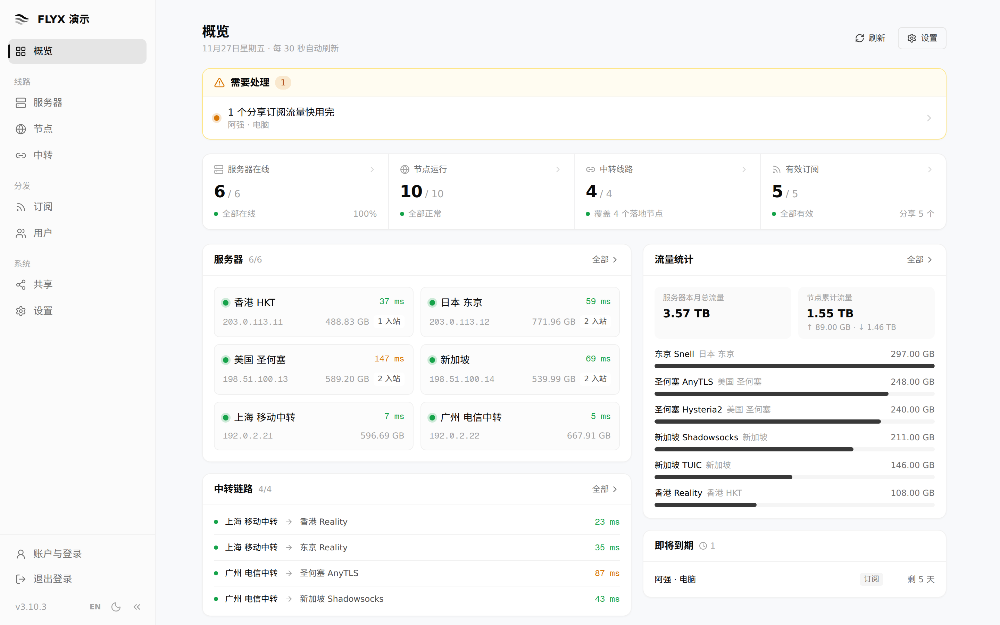
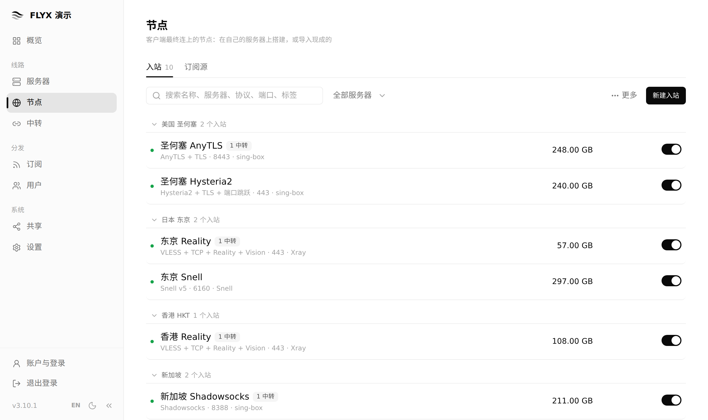
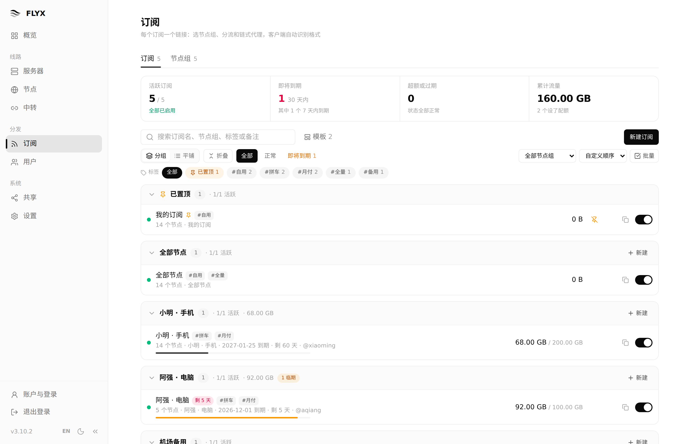
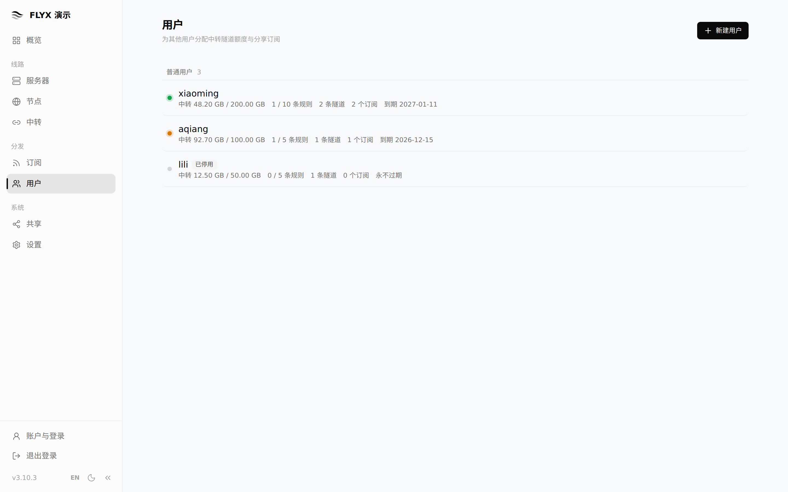
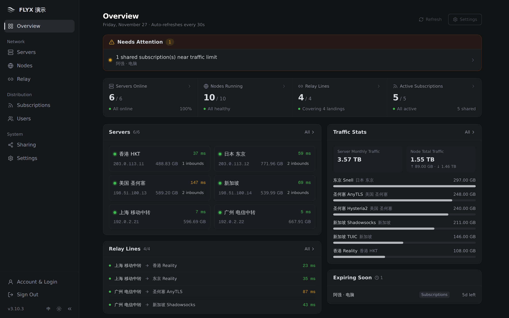

<div align="center">


# FLYX

**现代化的流量转发 + 多内核代理节点管理面板**

在一个面板里统一管理服务器、多内核节点、中转线路、订阅分发与轻量多用户。

[](https://github.com/kure29/flyx/releases)
[](LICENSE)
[](go-backend/go.mod)
[](vite-frontend/package.json)
[](https://t.me/flyx_chat)

**简体中文** · [English](README_EN.md)

[🚀 在线演示（支持管理员/用户双视角）](https://kure29.github.io/flyx/demo/) · [📖 使用文档](https://kure29.github.io/flyx/) · [⚡ 快速上手](https://kure29.github.io/flyx/guide/getting-started) · [📦 下载发布](https://github.com/kure29/flyx/releases)

<br />



</div>

<details>
<summary>📸 查看更多界面截图（节点管理 / 订阅分组与批量管理 / 轻量多用户 / 深色英文界面）</summary>

<br />

**节点与多内核管理**


**订阅分组、标签、置顶与批量管理**


**轻量多用户（中转配额与订阅分发）**


**深色模式 & 英文界面（支持实时中英切换）**


</details>

---

## ✨ 核心特性

- **多内核一键建节点**：按服务器安装与管理 **Xray**、**sing-box**、**Snell v4 / v5**（双列内核卡片、一键终端日志与重启、紧凑分段式 Agent 安装命令）；内置 VLESS Reality、Hysteria2（端口跳跃）、TUIC、AnyTLS、NaïveProxy、ShadowTLS、Shadowsocks / SS2022 等开箱即用模板
- **证书自动管理**：支持自签证书、本地证书文件，或由 sing-box 自动申请与续期（ACME HTTP / Cloudflare / 阿里云 DNS 验证）
- **灵活中转与流量转发**：支持 TCP / UDP 端口转发、加密隧道转发与多跳链路（如 前置 → IX → 落地），内置 GOST / realm / nftables 转发引擎，支持入站白名单、Proxy Protocol 透传真实 IP、中转与转发规则双向同步及按规则上下行统计
- **外部节点与订阅源导入**：粘贴分享链接、Clash / sing-box / Surge 配置或远程订阅 URL，外部节点同样可对接中转、参与编排与分发
- **Sub-Store 风格订阅与批量管理**：通过「节点组」统一挑选、过滤、去重、改名、脚本加工，支持**独立勾选落地直连与中转线路**；订阅支持**按节点组折叠分组、自定义标签、置顶、多维筛选排序、到期分级预警、拖拽排序、一键克隆与批量启停 / 续期 / 重置流量 / 标签管理**；支持分享订阅（独立凭据、流量限额、到期自动断开，Xray Shadowsocks / SS2022 支持按订阅独立密码与计量）
- **轻量多用户管理**：管理员可创建普通用户并分别分配中转隧道额度（流量上限、每月重置日、规则数上限、到期日）与关联订阅（中转与订阅额度分开计算）；普通用户登录后仅见精简门户（转发与我的订阅），超额/到期自动暂停、重置后自动恢复
- **延迟监控与三网回程**：定时检测服务器至电信 / 联通 / 移动节点延迟与丢包，自动识别 CN2 GIA / 9929 / CMIN2 等回程路由，提供趋势图与 Telegram / Webhook 异常告警
- **公开状态页与联邦共享**：内置免登录状态页（支持自定义主题，不暴露 IP 与协议细节）；支持跨面板联邦共享服务器端口与流量配额
- **现代交互与中英双语**：电脑端与移动端 H5 自适应布局，支持深浅色主题与 **简体中文 / English 实时切换**；支持 Passkey 通行证密钥与 GitHub OAuth 登录、JSON / GitHub Gist 加密备份以及面板内一键检查更新与自升级

---

## 🧩 协议与客户端支持

| 维度 | 支持范围 |
| --- | --- |
| **代理内核** | Xray-core · sing-box · Snell v4 / v5 |
| **节点协议** | VLESS (Reality / Vision / WS / gRPC / xHTTP) · VMess · Trojan · Shadowsocks / SS2022 · Hysteria2 · TUIC · AnyTLS · NaïveProxy · ShadowTLS · Snell |
| **转发引擎** | GOST（TCP / UDP / TLS / WS / WSS / mTLS 隧道）· realm · nftables |
| **订阅格式** | 自动识别客户端：Clash / Mihomo · sing-box · Surge · Stash · Shadowrocket · Loon · Quantumult X · 通用 Base64（支持自定义模板） |
| **数据库** | SQLite（开箱即用）· PostgreSQL |

---

## 🚀 快速部署

### 1. 安装面板（需要 Docker）

```bash
curl -L https://github.com/kure29/flyx/releases/latest/download/panel_install.sh -o panel_install.sh && chmod +x panel_install.sh && ./panel_install.sh
```

选择 `1. 安装面板`，安装完成后访问 `http://<服务器IP>:6366`：
- 默认账号：`admin_user` / `admin_user`（首次登录会引导修改用户名与密码）
- 后续可在面板 **设置 → 系统与升级** 中检查更新并一键升级

### 2. 接入服务器（Node Agent）

在面板 **服务器** 页点击「新建服务器」，复制自动生成的安装命令到目标服务器执行即可上线（支持 systemd 与 Docker 容器化部署）。

### 3. 在线体验

无需安装，直接打开 **[FLYX 在线演示](https://kure29.github.io/flyx/demo/)** —— 演示站支持右下角一键切换 **管理员 / 普通用户** 视角与 **中英文界面**（数据为浏览器端示例，刷新即还原）。

---

## 📚 文档导航

完整文档见 **[使用文档](https://kure29.github.io/flyx/)**：

- 入门：[基本概念](https://kure29.github.io/flyx/guide/concepts) · [快速上手](https://kure29.github.io/flyx/guide/getting-started) · [安装面板](https://kure29.github.io/flyx/guide/install) · [安装 Agent](https://kure29.github.io/flyx/guide/agent) · [服务器设置](https://kure29.github.io/flyx/guide/servers) · [升级指南](https://kure29.github.io/flyx/guide/upgrade)
- 节点与中转：[内核与协议](https://kure29.github.io/flyx/guide/kernels) · [新建入站](https://kure29.github.io/flyx/guide/nodes) · [导入节点](https://kure29.github.io/flyx/guide/import) · [对接中转](https://kure29.github.io/flyx/guide/relay) · [延迟与回程](https://kure29.github.io/flyx/guide/latency)
- 订阅与运维：[订阅与节点组](https://kure29.github.io/flyx/guide/subscription) · [凭据与流量限额](https://kure29.github.io/flyx/guide/subscription-users) · [公开状态页](https://kure29.github.io/flyx/guide/status-page) · [通知与备份](https://kure29.github.io/flyx/guide/backup) · [常见问题](https://kure29.github.io/flyx/guide/faq)

---

## 📄 许可与免责声明

- 本项目以 **GPLv3** 协议开源，详见 [LICENSE](LICENSE)；第三方组件来源与许可见 [NOTICE](NOTICE)。
- 本项目仅供个人学习与网络技术研究使用，仅限合法、合规用途。使用者须确保其使用行为符合所在国家或地区的法律法规，并自行承担使用本项目带来的一切风险。作者不对因使用本项目导致的任何后果承担责任，亦不提供任何形式的担保。禁止将本项目用于网络攻击、数据窃取、非法访问等任何违法或未经授权的行为。

---

## ⭐ 支持项目（USDT）

如果 FLYX 对你有帮助，欢迎点一颗 ⭐ Star 或请作者喝杯咖啡：

| 网络 | 地址 |
| --- | --- |
| **BNB (BEP20)** | `0x736f077bb3717b467d3da1576828dd6cbe089015` |
| **TRC20** | `TWjh5CRZ2qe1NxzPgHWkwLA9zgMUfjijpH` |
| **Polygon** | `0x736f077bb3717b467d3da1576828dd6cbe089015` |
