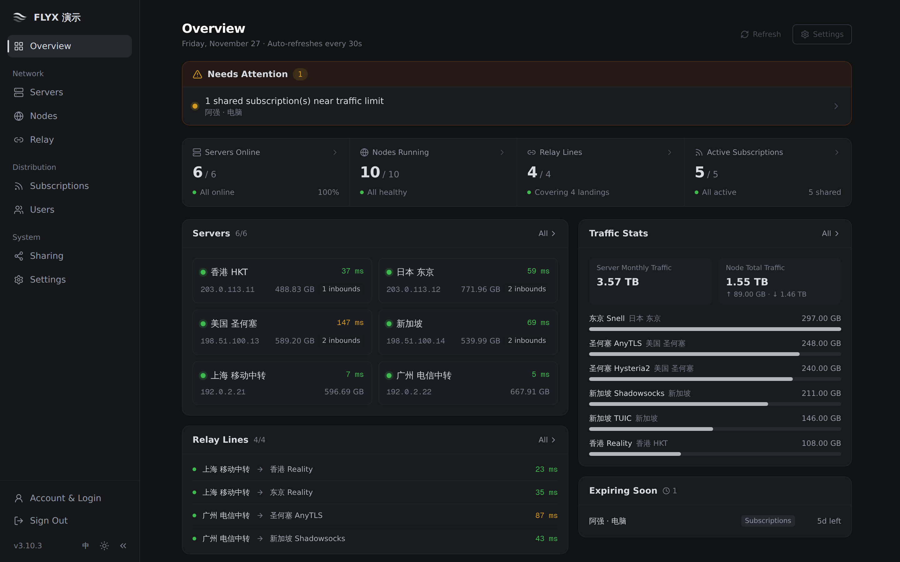
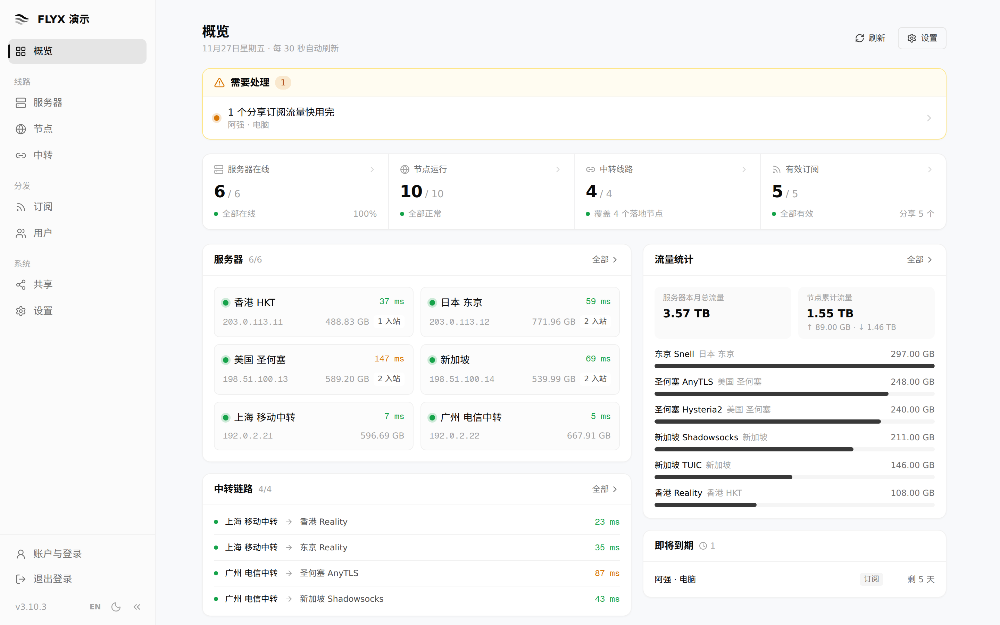
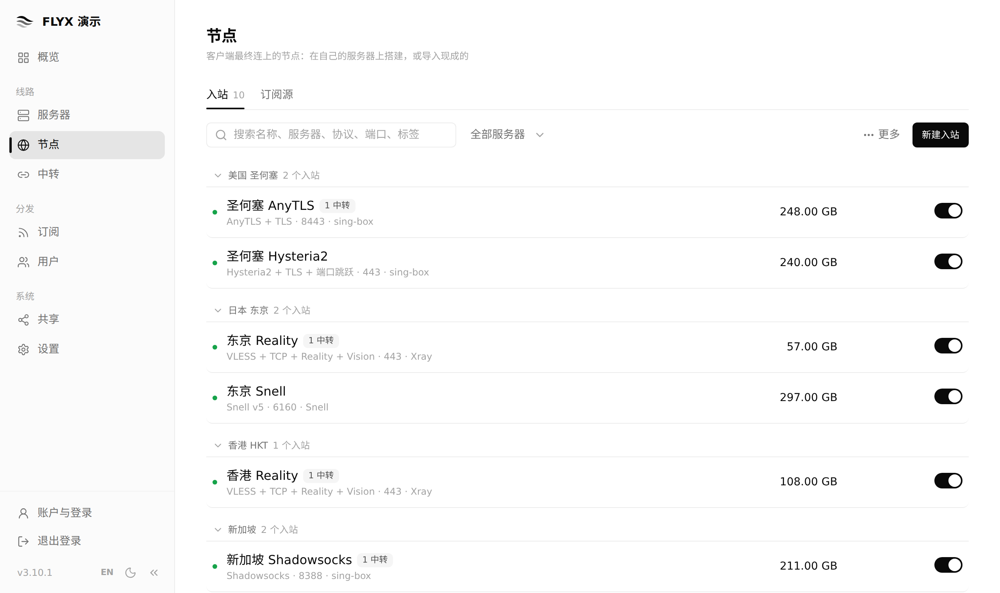
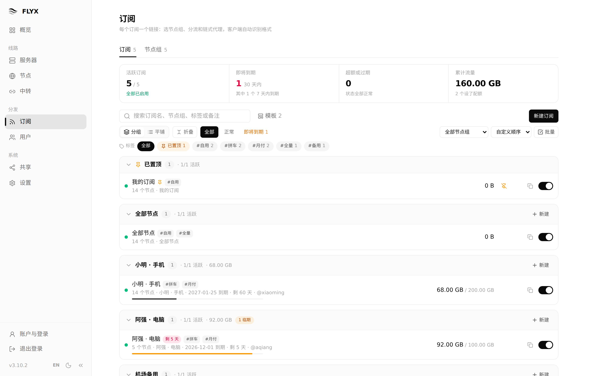
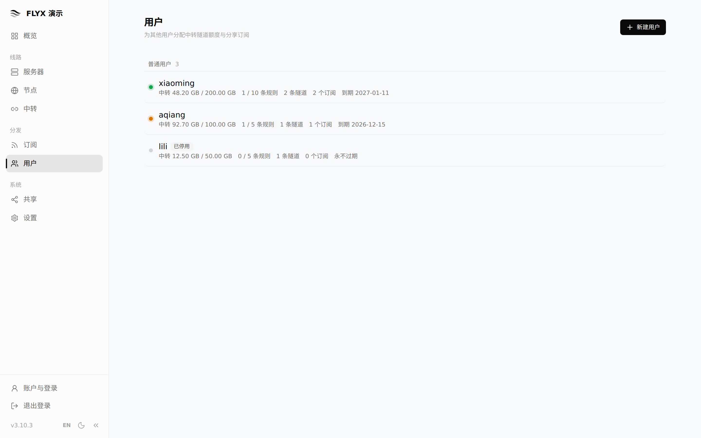

<div align="center">


# FLYX

**Modern Traffic Forwarding & Multi-Kernel Proxy Node Panel**

Manage servers, multi-kernel proxy nodes, relay tunnels, subscription distribution, and lightweight multi-user quotas in one clean panel.

[](https://github.com/kure29/flyx/releases)
[](LICENSE)
[](go-backend/go.mod)
[](vite-frontend/package.json)
[](https://t.me/flyx_notify)
[](https://t.me/flyx_chat)

[简体中文](README.md) · **English**

[🚀 Live Demo (Admin & User Views)](https://kure29.github.io/flyx/demo/) · [📖 Documentation](https://kure29.github.io/flyx/) · [⚡ Quick Start](https://kure29.github.io/flyx/guide/getting-started) · [📦 Releases](https://github.com/kure29/flyx/releases)

<br />



</div>

<details>
<summary>📸 More Screenshots (Overview Light / Nodes / Subscriptions / Multi-User)</summary>

<br />

**Overview (Light Mode)**


**Nodes & Multi-Kernel Management**


**Grouped Subscriptions, Tags, Pinning & Batch Actions**


**Lightweight Multi-User Quotas**


</details>

---

## ✨ Key Features

- **Multi-Kernel Node Deployment**: Install and manage **Xray**, **sing-box**, and **Snell v4 / v5** per server (two-column kernel cards, one-click dark terminal logs & restart, segmented agent install modal) with one-click presets for VLESS Reality, Hysteria2 (port hopping), TUIC, AnyTLS, NaïveProxy, ShadowTLS, Shadowsocks / SS2022, and more.
- **Automated TLS Certificates**: Supports self-signed certs, existing server certs, or automatic ACME issuance & renewal via sing-box (HTTP, Cloudflare, and Aliyun DNS).
- **Flexible Relay & Traffic Forwarding**: TCP / UDP port forwarding, encrypted tunnels, and multi-hop chains powered by GOST, realm, and nftables with real client IP passthrough, inbound allowlists, bidirectional relay/rule rename sync, and per-rule traffic accounting.
- **External Node & Source Import**: Paste share links, Clash / sing-box / Surge configs, or remote subscription URLs to attach relays and include them in subscriptions.
- **Sub-Store-Style Subscriptions & Anti-Sharing**: Bundle, filter, deduplicate, rename, and script nodes in reusable **Node Groups** with **independent direct vs. relay line selection**. Organize large deployments with **independent subscription groups, custom tags, pinning, multi-dimensional filters & sorting, expiry warnings, drag-and-drop ordering, one-click cloning, and batch enable/disable/extend/set-group/reset/tag actions**. Auto-detects client formats (Clash / Mihomo, sing-box, Surge, Shadowrocket, Loon, Quantumult X, Base64), supports per-subscription credentials, quotas, and expiry (including per-subscription Xray Shadowsocks / SS2022 metering), plus **cross-node concurrent online IP limits (alert / auto-resume temp suspend / auto-disable) and 24h subscription pull access logs & IP caps**.
- **Lightweight Multi-User Support**: Create normal users with independent relay tunnel quotas (traffic cap, monthly reset day, max rules, expiry) and assigned subscriptions. Users see a clean self-service portal (`Forwards` & `My Subscriptions`); over-quota or expired rules pause automatically and resume on reset.
- **Latency & Return-Route Monitoring**: Scheduled multi-ISP latency/loss probing, return route detection (CN2 GIA / 9929 / CMIN2), trend charts, and Telegram / Webhook alerts.
- **Public Status Page & Panel Federation**: Built-in public status page (customizable themes, hides IPs and protocols) plus cross-panel federated server sharing.
- **Modern Bilingual UI**: High-density desktop & responsive mobile H5 layouts, comfortable light/dark themes, instant **Chinese / English** switching, Passkey & GitHub OAuth sign-in, JSON / encrypted GitHub Gist backups, and in-panel self-upgrade.

---

## 🧩 Supported Protocols & Clients

| Category | Support |
| --- | --- |
| **Proxy Kernels** | Xray-core · sing-box · Snell v4 / v5 |
| **Protocols** | VLESS (Reality / Vision / WS / gRPC / xHTTP) · VMess · Trojan · Shadowsocks / SS2022 · Hysteria2 · TUIC · AnyTLS · NaïveProxy · ShadowTLS · Snell |
| **Forwarding Engines** | GOST (TCP / UDP / TLS / WS / WSS / mTLS tunnels) · realm · nftables |
| **Subscription Clients** | Auto-detected: Clash / Mihomo · sing-box · Surge · Stash · Shadowrocket · Loon · Quantumult X · Base64 (with custom templates) |
| **Databases** | SQLite (zero-config default) · PostgreSQL |

---

## 🚀 Quick Deployment

### 1. Install the Panel (Docker required)

```bash
curl -L https://github.com/kure29/flyx/releases/latest/download/panel_install.sh -o panel_install.sh && chmod +x panel_install.sh && ./panel_install.sh
```

Select `1. Install Panel`, then visit `http://<SERVER_IP>:6366`:
- Default credentials: `admin_user` / `admin_user` (you will be prompted to change them on first sign-in)
- Future upgrades can be triggered directly from **Settings → System & Upgrade**

### 2. Connect Servers (Node Agent)

Open **Servers → New Server** in the panel and run the generated install command on your target Linux server (supports both `systemd` and Docker container deployment).

### 3. Try the Live Demo

No installation needed — open the **[FLYX Live Demo](https://kure29.github.io/flyx/demo/)** and use the floating demo card to switch between **Administrator / User** views and **Chinese / English** in real time.

---

## 📄 License & Disclaimer

- Licensed under **GPLv3** — see [LICENSE](LICENSE) and third-party attributions in [NOTICE](NOTICE).
- This project is intended strictly for personal learning, research, and lawful network administration. Users are solely responsible for complying with applicable laws and regulations.

---

## ⭐ Support the Project (USDT)

| Network | Address |
| --- | --- |
| **BNB (BEP20)** | `0x736f077bb3717b467d3da1576828dd6cbe089015` |
| **TRC20** | `TWjh5CRZ2qe1NxzPgHWkwLA9zgMUfjijpH` |
| **Polygon** | `0x736f077bb3717b467d3da1576828dd6cbe089015` |
