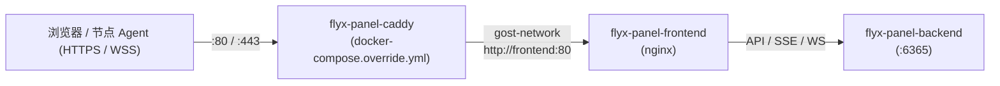

# FLYX 优化方案：流量统计、UI 细节与面板一键部署 HTTPS

基于用户反馈，结合当前代码库现状，按三个方向整理出可直接落地的实施方案与优先级建议。

---

## 一、流量统计优化

### 现状痛点
1. **已有 400 天历史数据未暴露**：`node_traffic` 表已按 15 分钟桶持久化 400 天服务器流量，但后端无历史聚合接口，总览页和节点监控页都看不到小时/日/月趋势。
2. **`statistics_flow` 断链**：[`SumStatisticsFlowSince`](../go-backend/internal/http/handler/notify_reports.go#L195) 查询 `statistics_flow` 用于生成 24h 转发流量日报，但当前无定时写入任务，导致该项恒为 0。
3. **口径与文案不一致**：
   - 节点监控 ([monitor-view.tsx](../vite-frontend/src/pages/node/monitor-view.tsx)) 用 `in = ↓` / `out = ↑`，而转发列表 ([forward.tsx](../vite-frontend/src/pages/forward.tsx)) 与隧道监控 ([tunnel-monitor-view.tsx](../vite-frontend/src/pages/node/tunnel-monitor-view.tsx)) 相反；
   - 节点设置自定义重置日（`trafficResetDay != 1`）时，界面仍固定显示“本月”与“按本地时区统计”，而 [`nodeTrafficMonth`](../go-backend/internal/http/handler/node_traffic.go) 实际按面板时区计算；
   - 流量单位格式化分散在 4 处实现（`formatTraffic`、`bytes`、`axisBytes`、`gbText`），小数位与单位缩写不统一。
4. **查询性能与图表体验**：
   - [`periodTraffic`](../go-backend/internal/http/handler/node_profile.go#L264) 按不同重置日循环调用 `NodeTrafficSince` 时未带 `node_id IN ?`，会重复全表聚合；
   - `monitor-view.tsx` 与 `tunnel-monitor-view.tsx` 的 Recharts 网格线、坐标轴、Tooltip 未适配暗色语义变量，且 `tunnel_metric` 无降采样与汇总 KPI。

### 实施方案

#### 1.1 后端接口与聚合优化
- **新增节点/全站流量历史接口** `POST /api/v1/node/traffic/history`（[node_traffic.go](../go-backend/internal/http/handler/node_traffic.go)）：
  - 入参：`{ nodeId?: number, range: "hour" | "day" | "month", tzOffset: number }`（`nodeId` 省略或 `0` 表示聚合全站在线/已配置节点）；
  - 复用 `subscription_traffic.go` 的按本地时区桶聚合逻辑，读取 `node_traffic` 15 分钟桶返回 `24h`（按小时）、`30d`（按日）、`12m`（按月）的 `inBytes`、`outBytes`、总计与当前计费周期起点 `since`。
- **优化 `periodTraffic` 查询**：在 `repository_metrics.go` 增加 `NodeTrafficSinceForNodes(fromMs int64, nodeIDs []int64)`，避免按重置日分组时重复扫全表。
- **修复 `statistics_flow` 日报统计**：优先直接复用 `tunnel_metric` 或按小时采样写入 `statistics_flow`，让日报里的 24h 转发流量恢复有效数据。
- **监控区间与降采样**：`monitor/tunnels/{id}/metrics` 增加 SQL 分桶降采样，避免大数据量直接 `LIMIT 5000` 截断。

#### 1.2 前端展示与体验升级
- **抽取通用历史流量图表组件**（复用并泛化 [traffic-stats.tsx](../vite-frontend/src/pages/subscription/traffic-stats.tsx)）：
  - 支持 `24h / 30d / 12m` 切换、下载/上传/合计 KPI 卡片、`ComposedChart`（面积图 + 虚线 + 重置日参考线）及可展开的明细条形表；
  - 接入 **总览页** ([admin-overview.tsx](../vite-frontend/src/pages/dashboard/admin-overview.tsx)) 的“流量统计” Bento 卡片与 **节点监控页** ([monitor-view.tsx](../vite-frontend/src/pages/node/monitor-view.tsx))。
- **统一口径与格式化**：
  - 将 `formatTraffic` / `formatTrafficCompact` / `formatTrafficAxis` 收敛到 [traffic.ts](../vite-frontend/src/utils/traffic.ts)；
  - 节点流量标签按 `trafficResetDay` 动态区分“本月”与“本周期”，并统一节点/转发/隧道的 `↑`（出站/上传）与 `↓`（入站/下载）语义；
  - 统一 `monitor-view.tsx` 和 `tunnel-monitor-view.tsx` 的暗色模式图表样式（`stroke="currentColor"`、`bg-content1`、`border-divider`）与英文 i18n 文案。

---

## 二、UI 细节打磨

按用户感知优先级分三批推进：

### 2.1 P0 — 暗色模式对比度与核心桥接组件修复
1. **修复 `Button` 桥接样式** ([button.tsx](../vite-frontend/src/shadcn-bridge/heroui/button.tsx))：
   - 替换不存在的 `bg-default/*` 为 `bg-default-100` / `bg-default-200`；
   - 修复暗色反转色阶导致的 `dark:text-default-300` 发暗不可读问题（改为 `dark:text-default-700` / `text-foreground`）；
   - 移除 `solidColorClassMap.danger` 对 `destructive` 实心红按钮的覆盖；
   - 让 `isIconOnly` 正确响应 `size="sm"`（`h-8 w-8`）。
2. **全局原生控件暗色适配** ([globals.css](../vite-frontend/src/styles/globals.css))：
   - `:root` 增加 `color-scheme: light;`，`.dark` 增加 `color-scheme: dark;`，一次性解决 15+ 处原生 `<select>`、`<input type="date">` 与滚动条在暗色模式下出现亮白弹窗的问题。
3. **修复低对比度文案与选中态圆点**：
   - [config.tsx](../vite-frontend/src/pages/config.tsx#L1514) 与更新确认弹窗移除 `dark:text-default-300`，并补齐 `tr()` 国际化；
   - [page-kit.tsx](../vite-frontend/src/components/page-kit.tsx#L856-L926) `WorkbenchLayout` 选中态状态点在暗色下改为语义色（与 `FilterPills` 一致），侧边栏列表加上 `desktop-scrollbar` 并将 `100vh` 替换为 `100dvh`。
4. **移动端弹窗默认留白** ([dialog.tsx](../vite-frontend/src/components/ui/dialog.tsx#L63)、[modal.tsx](../vite-frontend/src/shadcn-bridge/heroui/modal.tsx))：
   - 非 `full` 尺寸默认使用 `w-[calc(100%-2rem)] sm:w-full` 与 `p-5 sm:p-6`，避免窄屏贴边。

### 2.2 P1 — 表单控件、表格与登录页体验
- **统一表单焦点环与错误态** ([input.tsx](../vite-frontend/src/shadcn-bridge/heroui/input.tsx)、[select.tsx](../vite-frontend/src/shadcn-bridge/heroui/select.tsx)、[textarea.tsx](../vite-frontend/src/components/ui/textarea.tsx))：
  - 统一 `focus-visible:border-ring focus-visible:ring-2 focus-visible:ring-ring/25` 过渡动画；
  - 所有变体的 `Input` / `Textarea` / `Select` 在 `isInvalid` 时均展示 `border-danger`；
  - 修复单选 `Select` 在 `size="sm"` 下 `py-2` + `h-8` 导致的文字裁切。
- **登录页底部防遮挡** ([index.tsx](../vite-frontend/src/pages/index.tsx#L415-L443))：`VersionFooter` 从 `fixed bottom-4` 改为文档流布局，并将验证码弹窗改为语义色 Token。
- **表格与列表微调**：
  - [table.tsx](../vite-frontend/src/shadcn-bridge/heroui/table.tsx)、[node-views.tsx](../vite-frontend/src/pages/node/node-views.tsx)、[inbound-views.tsx](../vite-frontend/src/pages/inbound/inbound-views.tsx) 统一使用 `border-divider`、行 hover 与 `desktop-scrollbar`；
  - `ListRow` 最后一行去除多余底边框（`last:border-b-0`）；
  - 移动端 `AdminLayout` 抽屉支持 `Escape` 关闭与背景滚动锁定，`H5SimpleLayout` 返回按钮补齐 `aria-label`。

### 2.3 P2 — 补齐遗漏的中英文 i18n
- 补齐 `Select`（“请选择”“暂无可选项”）、`Table`（“加载中...”“暂无数据”）、`Modal`（`aria-label="关闭"`）、`node-views.tsx`（“不测延迟”）、`inbound-views.tsx`（健康状态与协议徽章）及 `panel-sharing.tsx` 的中英文翻译。

---

## 三、面板一键部署集成 HTTPS（`panel_install.sh`）

### 架构选型：Docker 版 Caddy + `docker-compose.override.yml`

#### 为什么采用 `docker-compose.override.yml` + Docker Caddy？
1. **天然兼容脚本更新与面板内自更新**：[`update_panel`](../panel_install.sh#L939-L999) 和 [`system_upgrade.go`](../go-backend/internal/http/handler/system_upgrade.go#L238-L307) 都会下载覆盖 `docker-compose.yml` 并执行无 `-f` 的 `docker compose up -d --force-recreate --remove-orphans backend frontend`。Compose 会自动合并 `docker-compose.override.yml`，因此 `caddy` 容器与证书卷不会被覆盖或误删。
2. **零宿主机包管理依赖**：只依赖已安装的 Docker，跨 Debian / Ubuntu / CentOS / Rocky / Alpine 行为完全一致。
3. **完整支持 FLYX 全链路**：Caddy 原生支持自动 ACME 续期、HTTP→HTTPS 跳转、WebSocket (`/system-info`)、SSE 诊断流 (`flush_interval -1`) 以及 33MB 状态页主题上传。

### 交互流程设计

1. **安装时可选引导**（`1. 安装面板` 流程末尾）：
   - 询问 `是否配置域名 HTTPS（通过 Caddy 自动申请证书或使用自定义证书）? (y/N)`；
   - 选择跳过则保持现有 HTTP 部署流程完全不变。
2. **新增独立管理入口**：主菜单新增 **`5. 配置 / 管理 HTTPS`**（`6. 退出`），支持对已部署的 HTTP 面板随时开启或维护，子菜单包含：
   - **自动申请证书（Let's Encrypt）**：输入域名（格式校验，禁止 IP/协议头）与可选邮箱，检测 80/443 端口占用，生成 `Caddyfile` 与 `docker-compose.override.yml` 并拉起 `caddy:2-alpine`；
   - **使用自定义证书**（适配 Cloudflare Origin Cert / 内网 / 与 443 SNI 复用共存的非标端口）：输入域名、HTTPS 端口（默认 443）、可选 HTTP 端口、证书与私钥路径（校验文件可读），只读挂载至 `/etc/caddy/certs/`；
   - **查看 HTTPS 状态 / 证书日志**：输出当前域名、模式与 `docker logs --tail 30`；
   - **关闭并回滚 HTTPS**：停止并移除 `caddy` 容器，删除 `docker-compose.override.yml` 与 `Caddyfile`，恢复纯 HTTP 访问。
3. **Passkey 联动**：开启 HTTPS 后自动提示写入 `FLYX_WEBAUTHN_ORIGIN=https://<domain>`（非 443 带端口）到 `.env` 并重建 `backend`，让 Passkey 登录开箱即用。

### 配套细节与防坑点
- **多面板实例隔离**：在 `.env` 中遵循现有命名规范写入 `PANEL_CADDY_CONTAINER`、`FLYX_CADDY_DATA_VOLUME`、`FLYX_CADDY_CONFIG_VOLUME`。
- **更新备份与回滚**：`update_panel` 备份/回滚逻辑同步覆盖 `docker-compose.override.yml` 和 `Caddyfile`；重建网络后若存在 `docker-compose.override.yml` 则一并拉起 `caddy`；`uninstall_panel` 同步清理这两个文件。
- **端口校验兼容性**：已在 PR #17 中放宽 [`validate_panel_update_environment`](../panel_install.sh#L491-L541) 对 `FRONTEND_PORT` / `BACKEND_PORT` 的校验，允许 `127.0.0.1:6366` / `[::1]:6366` 格式。
- **透传真实协议头**：在 [nginx.conf](../vite-frontend/nginx.conf) 中通过 `map $http_x_forwarded_proto` 保留上游反代传入的 `https`，不再硬编码覆盖为 `$scheme`。
- **保持测试脚本兼容**：保留 `panel_install.sh` 中 `# 执行主函数` 标记注释，确保 `test-install-scripts-proxy.sh` 与 `test-project-identity.sh` 继续通过。

---

## 四、建议实施顺序与验证方式

| 阶段 | 内容 | 验证方式 |
| --- | --- | --- |
| **Phase 1** | **UI 细节打磨**（P0 + P1 + P2） | `(cd vite-frontend && pnpm run lint && pnpm run build)`，逐项检查明/暗主题与移动端宽度 |
| **Phase 2** | **流量统计优化**（后端历史接口 + 查询优化 + 前端趋势图与口径统一） | `(cd go-backend && go test ./...)` + 前端 build + Demo 静态校验 |
| **Phase 3** | **面板一键部署 HTTPS**（`panel_install.sh` + `nginx.conf` + `doc/guide/install.md`） | `bash -n panel_install.sh`、`test-install-scripts-proxy.sh`、`test-project-identity.sh` + Compose 配置校验 |
